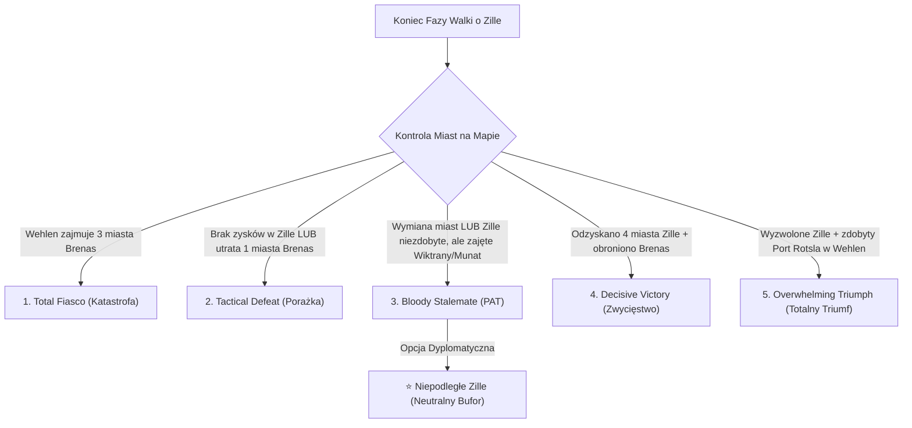

# 🗺️ THE GREAT ZILLE SOLUTION — MASTER ROADMAP & IMPLEMENTATION PLAN

> **Status projektu:** Wersja deweloperska 0.4.9 (MelonLoader / Unity 6000.3.9f1 Il2Cpp)  
> **Kompatybilność:** *Suzerain: Kingdom of Rizia* (Torpor Games)  
> **Główny cel:** Wprowadzenie pełnoprawnego, taktycznego i narracyjnego teatru militarnego wyzwolenia prowincji Zille z rąk Wiktora Smolaka (Wehlen).  
> **Jak korzystać z tego pliku:** Każda sekcja jest **rozwijana (`<details>`)**. Możesz klikać strzałki, zaznaczać checkboxy `[x]`, a w dedykowanych miejscach dopisywać własne pomysły, zadania i notatki.

---

## 💡 Rekomendowane Edytory do Pracy z tym Plikiem

Aby wygodnie zwijać/rozwijać sekcje i klikać checkboxy w czasie rzeczywistym:

1. **⭐ [Obsidian](https://obsidian.md/) (Rekomendacja #1):**
   - W 100% darmowy, lokalny, natywnie wspiera Markdown, tagi, checkboxy i zwijanie nagłówków/bloków `<details>`.
   - Znakomicie działa z repozytorium Git (wystarczy otworzyć folder projektu jako Obsidian Vault).
   - Posiada podgląd na żywo (*Live Preview*) — klikasz w checkbox i od razu się zaznacza, a sekcje rozwijasz jednym kliknięciem.
2. **💻 VS Code / Cursor / Windsurf (z rozszerzeniami):**
   - Jeśli pracujesz nad kodem w VS Code: zainstaluj wtyczkę **Markdown All in One** lub **Markdown Preview Enhanced**.
   - Wbudowane skróty do list zadań, integracja z gitem i podgląd obok kodu C#.
3. **✍️ MarkText / Typora:**
   - Lekkie edytory WYSIWYG (*What You See Is What You Get*) — ukrywają surowy kod znaczników i pozwalają edytować dokument jak w Wordzie / Notion, zapisując czysty plik `.md`.

---

## 📑 Spis Treści (Sekcje Rozwijane)

1. [ModLoader, Silnik i Patcher (MelonLoader / Harmony)](#1-modloader-silnik-i-patcher)
2. [Mechanika Hex-Wojny i Mapa Taktyczna (Zille War Table)](#2-mechanika-hex-wojny-i-mapa-taktyczna)
3. [Narracja, Dialogi i Web Editor (PixelCrushers)](#3-narracja-dialogi-i-web-editor)
4. [Wielki Konflikt Zaopatrzeniowy: Ścieżka Sazon vs Ścieżka Azaro](#4-wielki-konflikt-zaopatrzeniowy-ścieżka-sazon-vs-ścieżka-azaro)
5. [Geopolityka i Reakcje Międzynarodowe (Lespia, Derdia, Sordland, CSP)](#5-geopolityka-i-reakcje-międzynarodowe)
6. [5 Finałowych Scenariuszy Wojny i Traktaty Pokojowe ze Smolakiem](#6-5-finałowych-scenariuszy-wojny-i-traktaty-pokojowe)
7. [Dwufrontowa Wojna (Zille + Pales) i Ekonomia Zasobów](#7-dwufrontowa-wojna-zille--pales-i-ekonomia-zasobów)
8. [UI, Narzędzia Diagnostyczne (F9) i Web Editor 5050](#8-ui-narzędzia-diagnostyczne-f9-i-web-editor)
9. [Gazety Wojenne (The Royal Gazette, Wehlen Voice, Geopolitico) i Release Pipeline](#9-gazety-wojenne-i-release-pipeline)

---

<details open>
<summary><h3>1. 🏗️ ModLoader, Silnik i Patcher (MelonLoader / Harmony)</h3></summary>

> **Obecny stan:** Mod działa na **MelonLoader 0.6+** pod silnikiem Unity 6000.3.9f1 (Il2Cpp metadata v39). Usunięto błędy wczesnej inicjalizacji i ostrzeżenia. Hooki manualne wstrzykiwane w `DialogueInjectionPatches.cs`.

#### Zrealizowane w kodzie:
- [x] Naprawa crasha generatora asemblera Il2Cpp dla metadanych Unity v39 (`scripts/ml_fixes/`).
- [x] Główny punkt wejścia w `Core.cs` (`GreatZilleMod : MelonMod`, wersja 0.4.9).
- [x] Manualna rejestracja patchów Harmony w `DialogueInjectionPatches.RegisterManualPatches()`.
- [x] Ominięcie bootstrapowej sceny `Initialize` zapobiegające null-pointerom.
- [x] Skrypty wdrożeniowe: `deploy_mod.ps1`, `launch_modded.bat`, `launch_vanilla.bat`.

#### Zadania do wdrożenia:
- [ ] **Stabilizacja cyklu życia scen:** Upewnić się, że po wyjściu z mapy wojennej z powrotem do mapy świata lub sali tronowej obiekty stołu Zille są poprawnie chowane/czyszczone.
- [ ] **Optymalizacja raycastingu kursora:** Zoptymalizować częstotliwość wywołań w `HoverRaycast` i `RememberHoverPostfix`.

#### ➕ *Miejsce na Twoje notatki / nowe zadania w tej sekcji:*
- [ ] *(wpisz tutaj swoje zadanie...)*

</details>

---

<details open>
<summary><h3>2. ⚔️ Mechanika Hex-Wojny i Mapa Taktyczna (Zille War Table)</h3></summary>

> **Obecny stan:** Zaimplementowano stół wojenny `ZilleWarTable.cs`, układ kafelków z `zille_tiles_layout.json`, 4 miasta Wehlen w Zille (Zille, Wiktrany, Munat, Nanta) oraz 3 miasta osłonowe Rizii w Brenas (Marbelas, Dapalle, Mave Nortus).  
> **AI Wroga:** AI jednostek Smolaka/Wehlen korzysta bezpośrednio z **natywnego silnika wojennego Suzerain** (`WarFlowManager`, `WarTokenManager`, `WarBattleManager`).

```
                           [PORT ROTSLI (Wehlen)]
                                     ▲
                                     │ (Zaopatrzenie morskie)
                                     ▼
                            [MUNAT (Północny Port)]
                                   ▲
                                   │ (Szosa Nadmorska)
                                   ▼
 [ZILLE (Twierdza Główna)] ◄──► [WIKTRANY (Węzeł Centralny)] ◄──► [NANTA (Wschód)]
                                   ▲
                          (Przełęcz i Bagna)
                                   ▼
          ─────────────────────────────────────────────────────────────
                          DEMARKACJA GRANICY BRENAS
          ─────────────────────────────────────────────────────────────
               ▲                           ▲                         ▲
      [MARBELAS (Twierdza)]       [DAPALLE (Węzeł)]       [MAVE NORTUS (Dolina)]
```

#### Zrealizowane w kodzie:
- [x] Wyodrębnienie współrzędnych i tekstur kafelków z Pales i dostosowanie do teatru Zille.
- [x] Mechanika **Hold-to-Commit**: blokada natychmiastowych kliknięć, wymagająca przytrzymania przycisku myszy, zapobiegająca omyłkowym ruchom gracza.
- [x] Walidacja pól rozmieszczania jednostek: statki wyłącznie na polach wodnych, jednostki lądowe w miastach/terenach Brenas.
- [x] Naprawa połączeń linii zaopatrzenia (`WarSupplyLine.SetupTiles` i `SanitizeSupplyLines`).
- [x] Integracja natywnego rozstrzygania starcia i fazy wroga (`FinishBattle`, `WarBattleTurnResult`, `PlayerTurnPostfix`).

#### Zadania do wdrożenia:
- [x] **Specyfikacja Regionów dla Planów Operacyjnych (Wersja v14):**
  - [x] Opracowanie i walidacja list prowincji w `maps/zille/v14/regions/operation_regions_v14.json` (72/72 testów OK).
  - [x] **Plan Sword:** Faza 1 (137 kafelków: Zille 60 + Brenas 29 + Rotsla 96 + 47 mórz) -> Faza 2 (179 kafelków: cała mapa bez Derdii).
  - [x] **Plan Ark:** Faza 1 (130 kafelków: Wehlen 33 + Brenas 29 + pas Zille 11 + 57 mórz) -> Faza 2 (179 kafelków).
  - [x] **Plan Ark (Derdia):** Faza 1 (137 kafelków: Ark + 7 kafelków Derdii) -> Faza 2 (186 kafelków: cała mapa z Derdią).
  - [ ] Wdrożenie aktywacji/deaktywacji kafelków i blokad krawędzi (`boundary_edges_to_disabled`) w `ZilleWarTable.cs`.
- [ ] **Zachodni morski deployment zone (Ścieżka Sazon):**
  - [ ] Dodanie dedykowanego morskiego pola startowego po zachodniej stronie półwyspu Zille (dostępnego tylko przy wyborze logistyki Sazonów).
  - [ ] Oznaczenie flagi w `DialogueInjectionPatches.cs` i `ZilleDeployment.cs`.
- [ ] **Modyfikatory bojowe wyboru doktryny w Brenas:**
  - [ ] Aplikacja **+1 Defense** w kafelkach Brenas dla ścieżki Sazon.
  - [ ] Aplikacja **+1 Attack** w kafelkach Brenas dla ścieżki Azaro.
- [ ] **Warunki Zakończenia Operacji (5 Stanów Końcowych):**
  - [ ] Detektor rozstrzygnięcia: zliczanie kontrolowanych miast pod koniec fazy bitewnej i przekazanie wyniku do `WarOperationZilleManager`.

#### ➕ *Miejsce na Twoje notatki / nowe zadania w tej sekcji:*
- [ ] *(wpisz tutaj swoje zadanie...)*

</details>

---

<details open>
<summary><h3>3. 📜 Wątek Narracyjny, Dialogi i Web Editor (PixelCrushers)</h3></summary>

> **Obecny stan:** Zbudowano lokalny edytor narracyjny w przeglądarce (`editor/server.py`, port 5050), zapisujący nadpisania do `assets/mod_dialogue_overrides.json`. Dialogi wstrzykiwane w locie przez `DialogueOverrideManager.cs`.

#### Kluczowe Punkty Wstrzyknięć (Oś Czasu Gry):
* **Tura 1:** `EnT_CouncilBriefing` & `SnO_SecurityMilitaryMeeting` — pierwsze zbadanie opcji siłowej i rekonesans granicy Brenas.
* **Tura 2:** `FPnT_DiplomacyBriefing` & `FPnT_ZilleVisit` — konfrontacja z władzami okupacyjnymi i inspekcja zaopatrzenia.
* **Tura 3:** `SnO_ZilleSecurityDebrief` — reakcja na zamach bombowy w Zille; opcja przygotowania natychmiastowego uderzenia odwetowego.
* **Tura 4:** `FPnT_AlvarezCall` & `A_CouncilTalkAboutPales` — negocjacje z Lespią i spór o otwarcie frontu.
* **Tura 8:** `FPnT_ZilleNegotiations` — zerwanie rozmów ze Smolakiem w przypadku odmowy oddania Zille.
* **Tura 9:** Wyzwolenie inwazji przez `TokenInteractionPanel` (`Operation: Righteous Sword - Phase I`).

#### Zrealizowane w kodzie:
- [x] Pełny silnik lokalnego edytora webowego (`editor/server.py`, `app.js`, `style.css`).
- [x] Podgląd grafowy drzew dialogowych, filtr wyszukiwania i edycja pól węzłów.
- [x] Wstrzykiwanie opcji dialogowych w `DialogueInjectionPatches.OnSelectedResponsePrefix`.
- [x] Generowanie przycisku akcji inwazji na tokenie mapy w Turze 9.

#### Zadania do wdrożenia:
- [ ] **Dopisanie pełnych tekstów dialogowych do 5 scen końcowych:**
  - [ ] Rozmowa w namiocie polowym ze Smolakiem po klęsce / patcie / triumfie.
  - [ ] Specjalna ścieżka kompromisowa: **„Niepodległe Zille”** (Zille jako neutralny bufor).
- [ ] **Reakcje Rodziny Królewskiej:**
  - [ ] Rozmowa z Królową Matką Estelą (obrona jej rodzinnego Brenas przed zniszczeniem).
  - [ ] Rozmowa z Księżniczką Vieną (wpływ wojny na przyszłość królestwa i reformy).
  - [ ] Rozmowa z Hugo Torasem (obawy o stabilność dynastii i konserwatywny sprzeciw wobec ryzyka).

#### ➕ *Miejsce na Twoje notatki / nowe zadania w tej sekcji:*
- [ ] *(wpisz tutaj swoje zadanie...)*

</details>

---

<details open>
<summary><h3>4. 👑 Wielki Konflikt Zaopatrzeniowy: Ścieżka Sazon vs Ścieżka Azaro</h3></summary>

> **Tło fabularne konfliktu:**  
> Przed rozpoczęciem kampanii wojennej w Radzie Koronnej dochodzi do ostrego sporu o logistykę i zaplecze operacji.  
> * **Ród Sazon (Manus & Księżna Angelica):** argumentują, że najrozsądniej i najefektywniej jest zaopatrywać paliwo, amunicję i żywność **bezpośrednio z przyległej prowincji Brenas** (lokalne bazy, granice, spichlerze i szlaki rzeczne).  
> * **Dowództwo Azaro (Lucita & Taddeus):** jest wściekłe i głęboko nieufne. Generałowie Azaro nie wierzą, że arystokracja Sazonów udźwignie rygor wojenny, a w ich głowach tli się paranoiczny **lęk przed „nożem w plecy”** ze strony Brenas (strach całkowicie niesłuszny, wynikający z dawnych rodowych uprzedzeń).

---

#### 🏛️ ŚCIEŻKA 1: HOUSE SAZON (Wojna na Wykończenie & Atak w głąb Wehlen)
* **Koncepcja doktryny:** Oparcie zaplecza o Brenas. Strategia nastawiona na długą, metodyczną wojnę materiałową, twardą obronę własnych granic oraz przygotowanie uderzenia na rdzenne terytorium Wehlen.
* **Mechaniki i Efekty w Grze:**
  * ⚓ **Zachodni morski deployment zone:** Odblokowanie dodatkowego pola desantu morskiego na zachodzie półwyspu Zille (możliwość oskrzydlenia Wehlen od morza i marszu na północ ku Portowi Rotsla).
  * 🛡️ **+1 Defense w Brenas:** Wszystkie oddziały walczące na kafelkach prowincji Brenas otrzymują stały bonus do obrony dzięki lokalnemu wsparciu ludności i magazynom.
  * 💰 **Koszt:** `-1 Budżet na turę` (utrzymanie kontraktów gildii kupieckich i subsydiowanie spichlerzy).
  * 🌟 **Bonus Wysokich Relacji z House Sazon:**
    * Jeśli relacje z Sazonami są wysokie, ród rzuca na szalę wszystkie swoje siły:
    * 🎖️ **+1 Sazon Levies** (dodatkowy batalion poborowych piechoty Sazonów na starcie).
    * ⚡ **+1 Military Action Point (AP)** w każdej turze wojennej.

---

#### ⚔️ ŚCIEŻKA 2: HOUSE AZARO (Ogólnokrajowa Mobilizacja & Błyskawiczny Atak)
* **Koncepcja doktryny:** Odrzucenie lokalnych struktur Brenas. Cała machina zaopatrzeniowa ściąga zasoby na kampanię z całego królestwa poprzez scentralizowaną sieć kolejową i autostradową.
* **Mechaniki i Efekty w Grze:**
  * 🗡️ **+1 Atak w Brenas:** Zmasowany napływ ciężkiego sprzętu, paliwa rafineryjnego i amunicji z baz w Montaklarze daje oddziałom w Brenas natychmiastową premię do siły uderzeniowej (+1 Attack).
  * ⚡ **Koszt:** `-1 Energia na turę` (ogromne zapotrzebowanie na paliwo dla pociągów, konwojów ciężarówek i transportu strategicznego).
  * 🌟 **Bonus Wysokich Relacji z House Azaro:**
    * Jeśli relacje z Azaro są wysokie, sztab generalny pod wodzą Lucity działa z absolutną precyzją:
    * ⚡ **+1 Military Action Point (AP)** w każdej turze wojennej.

---

#### Zadania do wdrożenia w kodzie:
- [ ] **Wstrzyknięcie sceny narady logistycznej do bazy dialogów:**
  - [ ] Rozbudowa dialogu sporu sztabowego (`Conv_Zille_WarLogisticsDispute`).
  - [ ] Opcje dialogowe dla Romusa: Wybór Sazonów / Wybór Azaro.
- [ ] **Obsługa zmiennych stanu w `ZilleCampaignState.cs`:**
  - [ ] `Zille_Logistics_Route` (`"Sazon"` vs `"Azaro"`).
  - [ ] Sprawdzenie `HouseSazon_Opinion` i przyznanie `+1 Sazon Levies` oraz `+1 AP`.
  - [ ] Sprawdzenie `HouseAzaro_Opinion` i przyznanie `+1 AP`.
- [ ] **Aplikacja modyfikatorów w silniku walki `ZilleWarTable.cs`:**
  - [ ] Aktywacja zachodniego kafelka morskiego, gdy wybrana jest ścieżka Sazonów.
  - [ ] Doliczanie bonusu +1 Obrony (Sazon) lub +1 Ataku (Azaro) w kafelkach Brenas.
  - [ ] Pobieranie `-1 Budżetu` lub `-1 Energii` na początku tury operacyjnej.

#### ➕ *Miejsce na Twoje notatki / nowe zadania w tej sekcji:*
- [ ] *(wpisz tutaj swoje zadanie...)*

</details>

---

<details open>
<summary><h3>5. 🌍 Geopolityka i Reakcje Międzynarodowe (Lespia, Derdia, Sordland, CSP)</h3></summary>

> **Koncepcja:** Wojna z Wehlen angażuje sąsiadów i sojusze regionalne.

#### Kluczowi Aktorzy Zagraniczni:
* **Lespia (Patricio Alvarez):**
  - Dylemat Alvareza: Lespia może dostarczyć czołgi, wsparcie zwiadowcze i desant ATO pod Munat.
  - Warunek gracza: Alvarez żąda ustępstw w sprawie MITZ lub praw do wydobycia ropy.
* **Derdia (Wiseman Azmal):**
  - Jeśli Romus naprawił relacje z Azmalem: Nuryccy bojownicy przeprowadzają dywersję odcinającą węzeł Wiktrany.
  - Jeśli relacje są wrogie: Derdia zachowuje wrogość lub grozi prowokacjami granicznymi.
* **Sordland (Anton Rayne):**
  - Jeśli Rayne zawarł pakt z Wehlen (Operacja Bear Trap): Wehlen ma wsparcie polityczne z północy, a Rayne krytykuje Rizię w AN.
  - Jeśli Rayne odrzucił Smolaka: Sordland zachowuje neutralność.
* **CSP (Valgsland / Hegel & Contana):**
  - Jeśli Rizia zaatakuje rdzenne Wehlen (Port Rotsla), CSP może wystosować ultimatum lub zagrozić blokadą.

#### Zadania do wdrożenia:
- [ ] Odczyt zmiennych stanu świata (`GameFlow` / relacje z Derdią, Lespią i stan Sordlandu).
- [ ] Implementacja depesz dyplomatycznych i not w trakcie działań wojennych.

#### ➕ *Miejsce na Twoje notatki / nowe zadania w tej sekcji:*
- [ ] *(wpisz tutaj swoje zadanie...)*

</details>

---

<details open>
<summary><h3>6. 🕊️ 5 Finałowych Scenariuszy Wojny i Traktaty Pokojowe ze Smolakiem</h3></summary>

> **Koncepcja:** Koniec walki na mapie taktycznej automatycznie determinuje jeden z 5 stanów traktatu pokojowego.



#### Szczegóły Scenariuszy:
1. **Scenariusz 1: Total Fiasco (Katastrofalna Klęska):**
   * *Warunek:* Wehlen przełamuje obronę i okupuje Marbelas, Dapalle i Mave Nortus.
   * *Skutki:* -5 Budżetu, utrata suwerenności nad południem Brenas, gwarantowany pucz wojskowy lub detronizacja Romusa.
2. **Scenariusz 2: Tactical Defeat (Porażka Operacyjna):**
   * *Warunek:* Brak jakichkolwiek zdobyczy na półwyspie (Status Quo) lub utrata 1 miasta w Brenas.
   * *Skutki:* Zille pozostaje u Smolaka, Rizia płaci rekompensaty wojenne, upadek prestiżu monarchii.
3. **Scenariusz 3: Bloody Stalemate (Krwawy Impas / PAT):**
   * *Warunek:* Równowaga strat i zdobyczy (np. zdobycie Wiktranów przy utracie posterunku granicznego).
   * *Skutki:* Obie armie wykrwawione.
   * *⭐ Unikalna ścieżka:* **Traktat o Niepodległości Zille** — Romus wymusza wycofanie Wehlen, tworząc neutralne państwo Zille za drobne koncesje naftowe dla Smolaka.
4. **Scenariusz 4: Decisive Victory (Czyste Zwycięstwo):**
   * *Warunek:* Wyzwolenie 4 miast półwyspu (Zille, Wiktrany, Munat, Nanta) przy nienaruszonym Brenas.
   * *Skutki:* Bezwarunkowy powrót Zille do Korony Rizii. Smolak podpisuje kapitulację.
5. **Scenariusz 5: Overwhelming Triumph (Totalny Triumf):**
   * *Warunek:* Wyzwolenie Zille + uderzenie w głębię Wehlen (Port Rotsla).
   * *Skutki:* Wehlen płaci gigantyczne reparacje (+4 Budżet, +3 Energia), demilitaryzacja granicy, protektorat nad Grodzizg.

#### Zadania do wdrożenia:
- [ ] Funkcja `EvaluateWarOutcome()` w `WarOperationZilleManager.cs` przeliczająca kafelki po ostatniej turze operacji.
- [ ] Przekierowanie do dedykowanych konwersacji dialogowych dla każdego ze scenariuszy.
- [ ] Ustawienie flag w epilogu gry (zakończenia Rizii z uwzględnieniem statusu Zille).

#### ➕ *Miejsce na Twoje notatki / nowe zadania w tej sekcji:*
- [ ] *(wpisz tutaj swoje zadanie...)*

</details>

---

<details open>
<summary><h3>7. 📊 Dwufrontowa Wojna (Zille + Pales) i Ekonomia Zasobów</h3></summary>

> **Mechanizm dwufrontowy:** Gdy gracz decyduje się równolegle prowadzić wojnę z Axelem Reinhardtem (Pales) i Wiktorem Smolakiem (Wehlen).

#### Zasady Dwóch Frontów:
- [ ] **Podział Armii i Poboru:**
  - Pula jednostek zostaje rozdzielona między teatr Pales a teatr Zille.
  - Gracz musi świadomie dysponować oddziałami, decydując które dywizje uderzają na Pales, a które bronią Brenas i atakują Zille.
- [ ] **Drenaż Zasobów:**
  - Prowadzenie dwóch operacji wojennych nakłada dodatkowy koszt `-3 Budżet` i `-2 Energia` na turę.
- [ ] **Przełączanie Teatrów na Mapie:**
  - Płynne otwieranie właściwego teatru operacyjnego bez resetowania postępów drugiego.

#### ➕ *Miejsce na Twoje notatki / nowe zadania w tej sekcji:*
- [ ] *(wpisz tutaj swoje zadanie...)*

</details>

---

<details open>
<summary><h3>8. 🖥️ UI, Narzędzia Diagnostyczne (F9) i Web Editor 5050</h3></summary>

> **Obecny stan:** W grze pod klawiszem **F9** dostępne jest menu deweloperskie (`ZilleWarMapEditorUI`, `ZilleTheatreMenu`, `ZilleEventSpawnerUI`). W przeglądarce działa webowy edytor na porcie **5050**.

#### Zrealizowane w kodzie:
- [x] Przełączanie widoczności menu diagnostycznego pod klawiszem F9.
- [x] Spawner eventów i wymuszone otwieranie stołu wojennego (`EnterZilleWarTheatre`).
- [x] Podgląd i edycja pozycji kafelków (offsety, rotacja, skala) w locie.
- [x] Webowy edytor konwersacji i raportów (`launch_editor.bat`).

#### Zadania do wdrożenia:
- [ ] **Pasek Stanu Teatru Wojennego (In-Game HUD):**
  - Wyświetlanie aktualnego stanu kontroli miast (np. „Rizia: 3/7 | Wehlen: 4/7”).
  - Licznik tur operacyjnych (np. „Tura operacji: 2/4”).
- [ ] **Przycisk zakończenia tury operacji:** Dedykowany przycisk w panelu akcji Zille.

#### ➕ *Miejsce na Twoje notatki / nowe zadania w tej sekcji:*
- [ ] *(wpisz tutaj swoje zadanie...)*

</details>

---

<details open>
<summary><h3>9. 🗞️ Gazety Wojenne i Release Pipeline</h3></summary>

> **Obecny stan:** Zapisy i odczyt stanu gry działają w pełni natywnie w oparciu o silnik Suzerain i bazę `DialogueLua`.  
> **Co jest do zrobienia:** W modzie brakuje gazet reagujących na działania na froncie Zille oraz dopracowania gotowej paczki dystrybucyjnej.

#### Zadania do wdrożenia:
- [ ] **Nowe Gazety i Artykuły Prasowe:**
  - [ ] **The Royal Gazette (Rizia):**
    - Artykuł o wybuchu operacji wyzwoleńczej Zille.
    - Doniesienia z frontu o obronie miast Brenas i bohaterskich atakach na Wiktrany.
    - Wydanie specjalne po wyzwoleniu Zille lub zawarciu traktatu pokojowego.
  - [ ] **The Voice of Wehlen / Smolak Daily (Wehlen):**
    - Agresywna propaganda Wiktora Smolaka o „odparciu imperialistycznej agresji monarchii Torasów”.
    - Paniczne lub butne komunikaty w zależności od postępów wojsk Rizii.
  - [ ] **Geopolitico (Prasa Międzynarodowa):**
    - Analizy geopolityczne: reakcje Sojuszu Narodów (AN), obawy o kryzys uchodźczy, reakcje rynków naftowych na zamknięcie portu Munat.
- [ ] **Paczka Dystrybucyjna (Release Pipeline):**
  - [ ] Skrypt pakujący zbiór plików moda do gotowego archiwum `GreatZilleSolution_v1.0.zip`.
  - [ ] Czytelny plik `INSTRUKCJA_INSTALACJI.txt` dla graczy.

#### ➕ *Miejsce na Twoje notatki / nowe zadania w tej sekcji:*
- [ ] *(wpisz tutaj swoje zadanie...)*

</details>

---

## 🚀 Proponowany Porządek Prac (Najbliższe Kroki)

```
[KROK 1: Konflikt Zaopatrzeniowy Sazon vs Azaro w Kodzie i Dialogu]
  ├──> Wdrożenie logiki wyboru: Ścieżka Sazon (-1 Budżet, +1 Defense w Brenas, zachodni deployment morski)
  │    └──> Warunek relacji Sazon: +1 Sazon Levies, +1 AP
  └──> Wdrożenie logiki wyboru: Ścieżka Azaro (-1 Energia, +1 Attack w Brenas)
       └──> Warunek relacji Azaro: +1 AP

[KROK 2: Dopisanie Finałowych Scen Pokojowych ze Smolakiem (5 Scenariuszy)]
  └──> Edycja dialogów w Web Editorze (launch_editor.bat)
  └──> Scena traktatu pokojowego z opcją "Niepodległe Zille" w scenariuszu PAT

[KROK 3: Gazety Wojenne]
  └──> Artykuły The Royal Gazette, Wehlen Voice i Geopolitico opisujące przebieg inwazji

[KROK 4: Dwufrontowa Wojna (Zille + Pales)]
  └──> Sprawdzenie stanu wojny z Pales i podział puli dywizji
```

---
*Plik wygenerowany dla projektu **The Great Zille Solution**. Edytuj go dowolnie, dodając własne punkty w sekcjach `<details>`!*
