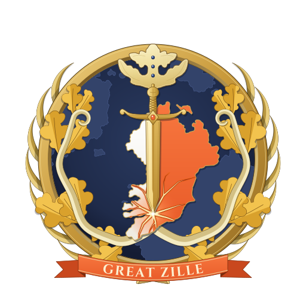

# Great Zille – logo & branding



The mod logo: a gold laurel wreath and crown in the style of the Kingdom of Rizia emblem, the real shape of the
Zille peninsula (v14 map, Zille in white and orange like the Rizian shield) and a gold sword driven into Zille City
(*Operation Golden Sword*).

Fan-made. The style follows the Kingdom of Rizia emblem from *Suzerain* (Torpor Games); the logo is not an official
Torpor Games asset. Mod assets are licensed under [CC BY-NC-ND 4.0](../LICENSE).

## Files

| Path | What |
|---|---|
| `svg/great_zille_logo.svg` | **Primary**, variant A (Zille white / orange), no text |
| `svg/great_zille_logo_ribbon_paths.svg` | Variant A with the "GREAT ZILLE" ribbon, text converted to outlines (use this one in production) |
| `svg/great_zille_logo_ribbon.svg` | Same with live `<text>` (needs the Cinzel font to render exactly) |
| `svg/*_b.svg` | Variant B, Zille in cream gold |
| `png/great_zille_logo[_ribbon][_b]_<size>.png` | Renders at 1024, 512, 256, 128, 64, 32, 16 px (ribbon versions from 128 px up; lettering is unreadable below that) |
| `ico/great_zille.ico` | Multi-size Windows icon (16-256 px, variant A) |
| `preview_sheet.png` | Overview of all variants, small sizes and a dark background |
| `source/` | Python generator (`gen8.py`, geometry cache, crown trace) and `build_branding.py` |

## Where it is used

* `README.md` header (this repo).
* **Game:** `assets/branding/` is deployed with the other assets to `Suzerain/Mods/GreatZilleAssets/branding/`
  and drawn by `src/GreatZilleSolution/ZilleBranding.cs`:
  ribbon logo on the Suzerain main menu (bottom-right), small icon next to the mod status bar (top-right) and in the
  Theatre menu (F11) title bar, and the Windows window/taskbar icon (`great_zille.ico`).
* **Web editor:** `editor/img/` (favicon + header logo in `editor/index.html`).
* **Start-menu shortcut:** `scripts/create_start_menu_shortcut.ps1` uses `great_zille.ico`.

## Rebuilding

```bash
pip install cairosvg pillow shapely fonttools
python3 branding/source/gen8.py branding/svg        # regenerate the SVGs (needs Cinzel, set GZ_LOGO_FONT=/path/Cinzel.ttf)
python3 branding/source/build_branding.py           # SVG -> PNG / ICO, refreshes assets/branding and editor/img
```

`gen8.py` is the final (v8) generator; `gen.py`, `gen5.py`-`gen7.py` are the earlier layers it builds on.
The map geometry is read from `source/geom_cache.pkl`, so the repo's map files are not needed to regenerate.
Only `great_zille_logo_ribbon_paths*.svg` needs the font (outlined text); the other SVGs are font-independent.
