# The Great Zille Solution: Definitywna Analiza Chronologii Wojny i Przesunięć Eventów (Turns 8–10)

*Dokument inżynierii przepływu gry (`GameFlow`), dekompozycji faz operacyjnych i harmonogramu przesunięć eventów dla moda „The Great Zille Solution”.*

---

## 1. Wstęp: Problem Przesunięć Eventów w Silniku Suzeraina

W vanillowym Suzerainie tury 8, 9 i 10 posiadają sztywno zaprogramowane kroki (`Steps`), w których przeplatają się wątki:
1. Sprawa Pales (Wojna o Aureus lub porozumienie pokojowe).
2. Sprawa Zille (Spotkania ze Smolakiem, referendum, przemówienie o zwrocie).
3. Polityka Wewnętrzna (Reforma konstytucyjna Manusa, urodziny Królowej Matki, zjazd rodów).
4. Sprawy Międzynarodowe (Wizyta u Beatrice w Rumburgu, szczyt Intermerkopum, mediacje z Morellą i Derdią).

Wprowadzenie pełnoprawnego, militarnego teatru wojennego w Zille rodzi kluczowe pytanie projektowe:
> **Czy warianty średni (Tura 8) i późny (Tura 9) wymuszają przesunięcie niektórych eventów vanilla na Turę 10 lub ich rekonfigurację?**

**Odpowiedź inżynieryjna brzmi: TAK, bezwzględnie.**
Bez dynamicznego przesunięcia lub zamrożenia wybranych kroków gracz w Turze 9 piłby popołudniową herbatkę z Beatrice w Thornbourgh (`Turn9_FPnT_GRACE_Rumburg_Meeting`) lub uczestniczył w wieczorze towarzyskim w Monqiz (`Turn9_FPnT_CallWithSmolak`), podczas gdy jego korpusy pancerne forsowałyby rzekę pod ostrzałem wehzekiej artylerii.

---

## 2. Architektura 3 Wariantów Czasowych i Fazy Bojowe

Zgodnie ze specyfikacją projektową moda i wytycznymi narracyjnymi, wprowadzamy rygorystyczny podział na 3 warianty inwazji o zróżnicowanej dynamice i kompresji faz:

```
┌──────────────────────────────────────────────────────────────────────────────────────────────────┐
│                               3 WARIANTY CZASOWE WOJNY O ZILLE                                   │
├──────────────────────────────────────────────────────────────────────────────────────────────────┤
│ WARIANT A (Wczesny – Tura 3/4): 4 TURY MAKSYMALNIE (T3/T4 -> T6/T7)                              │
│ • Rozpoczęcie: Po zamachu w Zille. Pales jest w stanie POKOJU (brak dylematu dwufrontowości).    │
│ • Faza I: Tura 4 (Przełamanie granicy). Faza II: Tura 5 (Zille & Wiktrany).                      │
│ • Rozstrzygnięcie i Traktat Pokojowy: Tura 6 (przed incydentem morskim z Pales!).                │
├──────────────────────────────────────────────────────────────────────────────────────────────────┤
│ WARIANT B (Środkowy – Tura 8): 3 TURY (Tura 8 -> Tura 9 -> Finał w T10)                          │
│ • Rozpoczęcie: Zerwanie negocjacji w Zille (Tura 8, Krok 12).                                    │
│ • Faza I: Tura 8 (Uderzenie wstępne).                                                            │
│ • Faza IIa & Faza IIb: TURA 9 (DWIE FAZY OPERACYJNE SKOMPRESOWANE W JEDNEJ TURZE!).              │
│ • Traktat Pokojowy: Początek Tury 10 (Krok 1).                                                   │
├──────────────────────────────────────────────────────────────────────────────────────────────────┤
│ WARIANT C (Późny – Tura 9): MAKSYMALNIE 3 FAZY (Dwie fazy w Turze 9, Jedna faza w Turze 10)     │
│ • Rozpoczęcie: Po sfałszowanym referendum w Zille (Tura 9, Krok 9/10).                           │
│ • Faza I: Tura 9 (Krok 11 – Błyskawiczny desant i przełamanie kordonu).                          │
│ • Faza II: Tura 9 (Krok 14 – Bitwa o węzeł Wiktrany i odcięcie Zille).                          │
│ • Faza III: TURA 10 (Krok 1 – Ostateczny szturm na miasto Zille i Port Rotsla).                  │
│ • Traktat Pokojowy: Tura 10 (Krok 2 – Natychmiast po wygaszeniu oporu).                          │
└──────────────────────────────────────────────────────────────────────────────────────────────────┘
```

---

## 3. Matryca Przesunięć i Kolizji Eventów Vanilla (Tura po Turze)

Poniższa analiza bada każdy krok vanilla w Turze 9 i 10 pod kątem logicznej koegzystencji z wojną o Zille.

### Analiza Kroków Tury 9 (Gdy trwa Wariant B lub C)

| Krok Vanilla | Nazwa Eventu Vanilla | Typ | Kolizja w Wariancie B (Faza IIa/IIb) | Kolizja w Wariancie C (Faza I/II) | Decyzja Systemowa Moda |
| :--- | :--- | :--- | :--- | :--- | :--- |
| **Step 1** | `Turn9_FPnT_Mediation` (Derdia/Morella/Wehlen) | Convo | **KRYTYCZNA:** Romus mediuje między Wehlen a Derdią, będąc w stanie wojny z Wehlen! | Brak (Wojna w T9 wybucha dopiero w Step 9) | **Dla War. B: `[INTERRUPT]`** – Mediacja z Wehlen anulowana. Odbywa się wyłącznie dwustronna mediacja Derdia-Morella. |
| **Step 2** | `Turn9_FPnT_MITZ_BoardMeeting` | Convo | Dopuszczalna (Romus uczestniczy zdalnie lub przez wysłannika, Lespia naciska na pokój). | Brak kolizji. | **`[FLAVOR INJECT]`** – Alvarez i Salane komentują wojnę na południu. |
| **Step 5** | `Turn9_Pipeline_NatDesMeeting` | Convo | Bardzo silny dysonans. Romus ogląda TV lub bada grób ojca w spokoju. | Brak kolizji. | **Dla War. B: `[BRANCH]`** – Narada sztabowa w podziemiach pałacu łączona z raportem o sabotażu. |
| **Step 6** | `Turn9_FPnT_IntermerkopumRoundtable` | Convo | **KRYTYCZNA:** Szczyt pokojowego sojuszu z udziałem Wehlen lub w czasie bitew pancernych. | Brak kolizji. | **Dla War. B: `[BRANCH]`** – Smolak jest nieobecny (zastąpiony przez uciekających dyplomatów); kraje żądają wstrzymania ognia. |
| **Step 7** | `Turn9_FPnT_GRACE_Rumburg_Meeting` | Convo | **FIZYCZNIE NIEMOŻLIWA:** Romus leci do Thornbourgh na herbatę z Beatrice podczas ofensywy. | Dopuszczalna (odbywa się tuż przed referendum). | **Dla War. B: `[PRZESUNIĘCIE / INTERRUPT]`** – Wizyta osobista zamieniona na pilne połączenie szyfrowane (gabinet łączności) lub przesunięta na Turę 10 po traktacie. |
| **Step 8** | `Turn9_FPnT_CallWithSmolak` | Convo | **CAŁKOWITY DYSONANS:** Romus spędza leniwy wieczór w Monqiz i odbiera kurtuazyjny telefon od Smolaka. | Dopuszczalna (ostatnie drwiny Wiktora przed referendum). | **Dla War. B: `[INTERRUPT]`** – Zastąpione przez *Event 5: Ostatnia Rozmowa ze Smolakiem* (Frontline Parley / War Hotline). |
| **Step 9** | `Turn9_FPnT_ZilleReferendum` | Convo | **NIE MA PRAWA SIĘ ODBYĆ:** Referendum w warunkach trwającej wojny to nonsens. | **PUNKT ZAPALNY WARIANTU C:** To tutaj ogłaszane jest fałszerstwo i rusza inwazja! | **Dla War. B: `[INTERRUPT]`** (Zablokowane).<br>**Dla War. C: `[TRIGGER]`** natychmiastowego uderzenia. |
| **Step 10** | `Turn9_FPnT_ZilleReferendumInterference` | Convo | Nonsens w War. B. | Finał operacji dywersyjnej w War. C. | **Dla War. B: `[INTERRUPT]`** (Skasowane). |
| **Step 12** | `Turn9_A_ZilleReturnedSpeech` | Convo | **KOLIZJA LOGICZNA:** Przemówienie dziękujące za dyplomatyczny zwrot Zille. | Wojna dopiero trwa, Zille nie jest zdobyte. | **Dla War. B i C: `[BLOKADA / PRZESUNIĘCIE NA TURĘ 10]`** – Odpala się wyłącznie w Turze 10 po podpisaniu korzystnego Traktatu Pokojowego (Stany 4 i 5)! |
| **Step 13** | `Turn9_A_TalkWithManus` / `Adarfo` | Convo | Opozycja żąda zakończenia wojny. | Opozycja reaguje na referendum. | **`[BRANCH]`** – Manus stawia ultimatum w sprawie poboru. |
| **Step 15** | `Turn9_A_TalkWithTitus` (Urodziny Matki) | Convo | Titus przygotowuje ochronę urodzin w cieniu wojny. | Titus raportuje o zabezpieczeniu tyłów frontu. | **`[FLAVOR INJECT]`** – Titus ostrzega przed rakietami Wehlen na stolicę. |

---

### Analiza Kroków Tury 10 (Gdy trwa Finał Wariantu B lub Faza III Wariantu C)

W Turze 10 gra zmierza ku wielkiemu finałowi: Urodziny Królowej Matki, Podpisanie Konstytucji, Rozstrzygnięcie Wojny z Pales, Ewentualny Pucz.

```
┌──────────────────────────────────────────────────────────────────────────────────────────────────┐
│                           NOWA SEKWENCJA KROKÓW DLA TURY 10 (WARIANT B & C)                     │
│                                                                                                  │
│ [KROK 1: TEATR WOJENNY ZILLE]                                                                    │
│ • Dla Wariantu B: Podpisanie Traktatu Pokojowego (SnO_ZillePeaceTreatyFinal - 5 Stanów).         │
│ • Dla Wariantu C: Faza III Operacji Zille (Szturm generalny) -> Natychmiastowy Traktat.          │
│                                                                                                  │
│ [KROK 2: ORĘDZIE WOJENNE I ZWROT ZILLE]                                                         │
│ • Zamiast pokojowego przemówienia z Tury 9, odpala się Zmodyfikowane Orędzie Zwycięstwa/Żałoby   │
│   (Turn10_A_ZillePostWarSpeech). Flagi mapy aktualizują prowincję Zille.                         │
│                                                                                                  │
│ [KROK 3: SPRAWY RODZINNE & URODZINY KRÓLOWEJ MATKI]                                             │
│ • Turn10_RelationshipAnnouncement (Lucita / Pabel).                                             │
│ • Turn10_P_BirthdayGathering: Bankiet urodzinowy Esteli odbywa się w nowym świetle:             │
│   - Jeśli Zwycięstwo/Triumf: Estela wznosi toast za ocalenie syna i powrót Zille.               │
│   - Jeśli Fiasko/Impas: Urodziny w grobowej atmosferze; ród Azaro i Toras na krawędzi puczu.     │
│                                                                                                  │
│ [KROK 4: REFORMA KONSTYTUCYJNA & RADA KRÓLEWSKA]                                                │
│ • Turn10_Reform_ConstitutionSigning (Manus) oraz Turn10_A_CouncilMeet.                          │
│ • Wynik traktatu determinuje stabilność państwa (Autorytet, Budżet, Lojalność Armii).           │
│                                                                                                  │
│ [KROK 5-10: ROZLICZENIE PALES & EPILOGI REGIONALNE]                                             │
│ • Rozliczenie Pales (Wojna lub Unifikacja) z uwzględnieniem strat poniesionych w Wehlen.         │
└──────────────────────────────────────────────────────────────────────────────────────────────────┘
```

#### Dokładne Rozstrzygnięcie: Co PRZESUWAMY na Turę 10?
1. **`Turn9_A_ZilleReturnedSpeech` $\rightarrow$ Przesunięte do Tury 10 (Krok 2):** 
   W wariantach wojennych Zille fizycznie nie może wrócić do Korony w Turze 9. Przemówienie zostaje przeniesione do Tury 10 i całkowicie przepisane: w vanilli Romus chwali sukces dyplomatyczny, w modzie Romus składa hołd poległym i ogłasza warunki traktatu ze Smolakiem.
2. **`Turn9_FPnT_GRACE_Rumburg_Meeting` (High Tea with Beatrice) $\rightarrow$ Warunkowa adaptacja:**
   - W Wariancie B Romus **nie może opuścić kraju**. Zamiast tego krok ten zostaje zastąpiony przez połączenie telefoniczne / szyfrogram wojenny z Beatrice, a pełne spotkanie z Królową Rumburgu zostaje zrealizowane jako audjencja podsumowująca w Turze 10 (jeśli Romus wygrał i zabezpieczył ropę).
3. **Mediacja Derdia-Wehlen (`Turn08_Decision_MediateDerdiaWehlen` / `Turn9_FPnT_Mediation`) $\rightarrow$ USUNIĘTA:**
   Jeśli Romus toczy wojnę ze Smolakiem, Wehlen nie prosi Rizii o arbitraż religijny z Derdią. Ten fragment w całości wypada z gry (`[INTERRUPT]`), zwalniając przestrzeń czasową w Turze 9 na dwie fazy bitewne!

---

## 4. Szczegółowy Harmonogram Wstrzyknięć 6 Eventów Modyfikacji

Poniższy diagram ilustruje dokładną pozycję 6 unikalnych eventów moda na osi czasu gry dla każdego z trzech wariantów:

```mermaid
flowchart TD
    subgraph Wariant A [Wczesny: Tura 3/4]
        A1["Tura 4, Krok 1: Zille Invasion Briefing (9988)"] --> A2["Tura 4, Krok 3: Zille War Speech"]
        A2 --> A3["Tura 4, Krok 7: Spór Logistyczny Azaro vs Sazon"]
        A3 --> A4["Tura 6, Krok 2: Narada Przednegocjacyjna & Telefony"]
        A4 --> A5["Tura 6, Krok 3: Ostatnia Rozmowa ze Smolakiem"]
        A5 --> A6["Tura 6, Krok 4: Traktat Pokojowy (5 Stanów)"]
    end

    subgraph Wariant B [Środkowy: Tura 8]
        B1["Tura 8, Krok 2: Zille Invasion Briefing (9988)"] --> B2["Tura 8, Krok 4: Zille War Speech"]
        B2 --> B3["Tura 8, Krok 6: Spór Logistyczny Azaro vs Sazon"]
        B3 --> B4["Tura 9, Krok 6: Narada Przednegocjacyjna & Telefony"]
        B4 --> B5["Tura 9, Krok 8: Ostatnia Rozmowa ze Smolakiem"]
        B5 --> B6["Tura 10, Krok 1: Traktat Pokojowy (5 Stanów)"]
    end

    subgraph Wariant C [Późny: Tura 9]
        C1["Tura 9, Krok 10: Zille Invasion Briefing (9988)"] --> C2["Tura 9, Krok 11: Zille War Speech"]
        C2 --> C3["Tura 9, Krok 12: Spór Logistyczny (Szybka Decyzja)"]
        C3 --> C4["Tura 10, Krok 1: Narada Przednegocjacyjna & Faza III"]
        C4 --> C5["Tura 10, Krok 2: Ostatnia Rozmowa ze Smolakiem"]
        C5 --> C6["Tura 10, Krok 3: Traktat Pokojowy (5 Stanów)"]
    end
```



---

## 5. Podsumowanie Wniosków dla Systemu GameFlow
1. **Dwuetapowość Tury 9 w Wariancie B i C:**
   Tura 9 posiada wystarczającą liczbę kroków systemowych (`Step 1` do `Step 15`), by pomieścić dwie fazy operacji wojennej. Faza I odpala się we wczesnym segmencie tury, a Faza II po kroku sabotażu rurociągu (`Step 5/6`).
2. **Konieczność Blokady Referendum w War. B:**
   Wyciszenie eventów `Turn9_FPnT_ZilleReferendum` i `Turn9_FPnT_ZilleReferendumInterference` w Wariancie B jest absolutnym priorytetem technicznym.
3. **Płynne Przejście do Urodzin Królowej Matki w Turze 10:**
   Dzięki umieszczeniu Traktatu Pokojowego na samym początku Tury 10 (Krok 1), Królowa Matka Estela i arystokracja w Kroku 2 mogą w pełni autentycznie zareagować na ostateczny rezultat wojny, co nadaje scenie urodzinowej bezprecedensowy ładunek emocjonalny.
